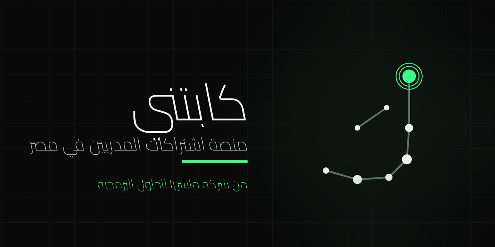

# Captainy | كابتني

**An Arabic-first subscription platform for fitness coaches in Egypt, built by Eng. Kareem Ezz Eldin.**

Workout and diet plans, client follow-up and monthly subscriptions — all in simple Egyptian Arabic.

A [MASRIA](https://masria-tech.vercel.app) product | Arabic (RTL) | Mobile-first PWA

---

## Preview

## What it is

Captainy gives every fitness coach ("كابتن") a private, fully isolated space for his own clients. A coach invites clients with a link, builds their workout and diet plans, follows their reports and renewals, and chats with them — while each client sees only their own coach and their own plan. No marketplace, no distractions: the coach's brand comes first.

## Features — 22

**For the coach**
- A private coach space with complete client isolation (multi-tenant by design)
- Client invite links — a client joins only through his coach
- Workout plan builder with reusable templates the coach can edit before assigning
- Diet plan builder with daily meals
- Personal exercise library: name, muscle, video and instructions, insertable into any plan
- Workout reports from every client after each session
- A follow-up queue that surfaces expiring subscriptions and missing reports
- Contextual comments on any exercise inside a client's plan
- Private two-way messaging with each client
- Weekly client reviews: sleep, energy, hunger and stress
- Subscription tracking with manual payment recording (InstaPay, wallets, cash)

**For the client**
- Guided workout mode with a live session timer
- Rest timer after every set, shown as a full-screen overlay
- Exercise videos inside the app
- The diet plan, always up to date
- Progress tracking for weight and measurements
- Optional private progress photos — visible only to the client and his coach, deletable anytime
- A weekly check-in form
- Daily reminder notifications
- Private messages with the coach in one place
- Installable on the phone like a native app (PWA)
- A simple Egyptian-Arabic interface, designed for mobile first

## Free to start

Every coach starts free with his first 3 clients — no card required.

## Built with

Next.js, React, TypeScript, Tailwind CSS, Firebase (Auth, Firestore, Security Rules), Vercel and PWA.

## About this repository

This repository is a public showcase only. The source code is private.

## Contact

Built and maintained by **Kareem Ezz Eldin** ([@Kareem569-coder](https://github.com/Kareem569-coder)).

Captainy is a product of **MASRIA** for software solutions — [masria-tech.vercel.app](https://masria-tech.vercel.app).

&copy; 2026 MASRIA. All rights reserved.
